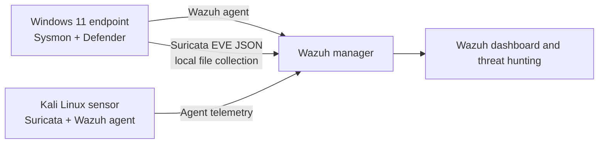

# SOC Endpoint Detection & Response Lab

A hands-on Blue Team portfolio project demonstrating endpoint telemetry collection, security monitoring, threat hunting, and investigation workflows using **Wazuh, Windows Sysmon, Microsoft Defender, Suricata, and OpenSearch Dashboards**.

> **Project status:** Active lab / proof of concept. This repository documents a personal virtualized environment. It is not a production SOC, 24/7 monitoring service, or a claim of guaranteed incident response capability.

## Executive overview

This project brings together endpoint and network security telemetry in a central Wazuh environment. It demonstrates how an analyst can review alert volume, examine trends, compare endpoint activity, identify frequently triggered rules, and use MITRE ATT&CK mappings to add context to detections.

The work is presented as a practical portfolio and a basis for a **scoped client demonstration or discovery discussion**. Any client deployment would require a separate environment assessment, written authorization, agreed monitoring scope, privacy controls, and service-level definition.

## SOC monitoring dashboard

The custom **SOC – Security Operations Centre** dashboard combines operational metrics with alert investigation views.

### Operational KPI panels

| Panel | What it communicates |
|---|---|
| Total Security Alerts | Overall alert volume for the selected time range. |
| High-Severity Alerts | Count returned by the dashboard's configured high-severity filter. |
| Critical Security Alerts | Count returned by the configured critical-severity filter. |
| Windows Defender Detections | Alerts matching the configured Windows Defender rule group. |

The KPI values are time-range dependent and should be interpreted with the dashboard's selected time filter. They are snapshots from the lab, not service-level or threat-prevalence measurements.

### Monitoring and investigation panels

| Panel | Analyst use |
|---|---|
| Security Alerts Over Time | Highlights changes and spikes in alert volume over the selected period. |
| Recent Security Alerts | Provides a tabular view of alert records, including endpoint, severity, rule ID, description, and record count. |
| Severity Distribution | Shows the distribution of alert rule levels. Wazuh rule levels are numeric severity scores; the organization's severity bands should be explicitly defined rather than assumed to be universal. |
| Alerts by Agent | Compares alert volume across enrolled agents/endpoints. |
| Top 10 Detection Rules | Identifies the most frequently represented Wazuh rule IDs in the selected time range. |
| Top MITRE ATT&CK Techniques | Groups alerts by the MITRE technique IDs present in the alert data, helping guide threat-hunting pivots. |

**Analyst interpretation:** These panels support triage prioritization and investigation pivots. A high alert count does not automatically mean a successful compromise; alerts need validation against endpoint context, event details, and supporting telemetry.

## Threat-hunting dashboard

A separate Wazuh **Threat Hunting** dashboard is used to explore alert-level trends and endpoint activity. The supplied dashboard views include:

- Alert-level evolution over time, broken down by Wazuh rule levels.
- Top MITRE ATT&CK techniques, displayed with technique names.
- Top agents by alert volume.
- Alert evolution for the leading agents.
- Summary counters for total alerts, level-12-or-above alerts, authentication failures, and authentication successes.

These are investigative views over the selected Wazuh data and time range. They are not, by themselves, proof of a confirmed incident or of successful authentication attack prevention.

## Lab architecture

The diagram shows the configured lab design. Individual sources are marked with their verification status in [implementation status](docs/implementation-status.md).

## Technology stack

| Area | Technology |
|---|---|
| SIEM / endpoint monitoring | Wazuh manager, agents and dashboard |
| Search and visualization | OpenSearch Dashboards |
| Windows telemetry | Sysmon, Windows Event Log, PowerShell |
| Endpoint protection | Microsoft Defender Antivirus |
| Network IDS | Suricata 8.0.8, Emerging Threats Open rules |
| Test environment | VMware virtual machines, Windows 11, Amazon Linux, Kali Linux |
| Investigation | PowerShell, event IDs, JSON EVE logs, MITRE ATT&CK mappings |

## Verified investigation highlight

A controlled Atomic Red Team PowerShell test (MITRE ATT&CK **T1059.001 – PowerShell**) was attempted on the Windows endpoint. Microsoft Defender recorded:

- **Event 1116:** detection of `Trojan:Win32/Powessere.K` (Threat ID `2147734747`).
- **Event 1117:** remediation action `Remove`, with status indicating successful completion.
- The Atomic test itself did **not** complete successfully; the expected marker artifacts were absent.
- These Defender events were verified in the endpoint's local event log. Their receipt and indexing in Wazuh were **not confirmed for this particular test**.

A later Wazuh alert export also contained Windows Defender Event ID 1116 detections from the Atomic Red Team archive. The exported records included 58 alert documents and 57 unique detection IDs in that export. The export contained no Event ID 1117 records; this does not establish whether such events exist in raw archives outside that export's scope.

See the [investigation record](docs/investigations/defender-atomic-t1059-001.md) for evidence and limitations.

## Implementation status

| Capability | Status |
|---|---|
| Wazuh manager and endpoint agents | Configured; endpoint alerts visible in dashboard |
| Windows Sysmon collection | Configured; agent log confirms channel monitoring |
| Windows Defender event-channel collection | Configured locally; Defender detections also appear in a Wazuh alert export |
| Suricata configuration and rules validation | Configuration test passed |
| Suricata EVE generation | Local DNS and flow events observed |
| Suricata EVE ingestion into Wazuh | Configured for collection; end-to-end indexing not yet verified |
| Sigma detections | Planned |
| TheHive case-management integration | Planned |

Detailed notes: [Architecture](docs/architecture.md) · [Dashboard overview and snapshot notes](docs/dashboard-overview.md) · [Implementation status](docs/implementation-status.md) · [Evidence guide](evidence/README.md).

## Potential client demonstration scope

This lab can support a **scoped technical demonstration** of:

1. Endpoint telemetry visibility and Wazuh agent onboarding.
2. Windows event-source configuration and alert review.
3. Dashboard-based alert triage, severity review, and endpoint comparisons.
4. MITRE ATT&CK-oriented threat-hunting pivots using available alert mappings.
5. A Suricata network IDS proof of concept.
6. A documented investigation walkthrough with evidence and limitations.

A real-world engagement would begin with discovery and authorization, followed by asset and log-source scoping, secure deployment design, alert-tuning requirements, retention/privacy decisions, escalation paths, and acceptance criteria. This portfolio does **not** claim continuous monitoring, managed SOC coverage, compliance certification, or guaranteed threat prevention.

## Repository map

- `docs/architecture.md` — components and telemetry flow.
- `docs/implementation-status.md` — what is configured and what remains unverified.
- `docs/dashboard-overview.md` — SOC and threat-hunting dashboard descriptions, snapshot values, and report interpretation.
- `docs/investigations/` — investigation notes and event evidence.
- `docs/security-and-privacy.md` — safe lab operation and data handling.
- `docs/service-demonstration-scope.md` — realistic proof-of-concept demonstration scope.
- `evidence/` — guidance for adding sanitized screenshots and sample evidence.

## Safety and responsible use

All testing should be performed only on systems you own or are explicitly authorized to assess. Do not publish credentials, API keys, private environment details, raw endpoint logs, or unredacted personal data. Never disable endpoint protection or weaken security controls merely to force a test to run.

See [Security & Privacy](docs/security-and-privacy.md).
