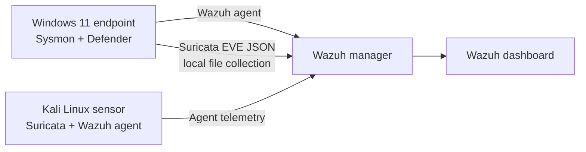

# SOC Endpoint Detection & Response Lab

A hands-on Blue Team portfolio project demonstrating endpoint telemetry collection, security monitoring, network intrusion detection, and investigation workflows using **Wazuh, Windows Sysmon, Microsoft Defender, and Suricata**.

> **Project status:** Active lab / proof of concept. This repository documents a personal virtualized environment. It is not a claim of a production SOC, 24/7 monitoring service, or guaranteed incident response capability.

## What this project demonstrates

- Centralized security monitoring with a Wazuh manager and endpoint agents.
- Windows endpoint telemetry using Sysmon and Windows event channels.
- Network security telemetry using Suricata and Emerging Threats Open rules.
- Investigation of a controlled PowerShell test that triggered a Microsoft Defender detection.
- Evidence-led documentation that distinguishes local detection, agent collection, manager receipt, and dashboard alerting.

## Lab architecture

The diagram shows the intended telemetry paths configured in this lab. Individual sources are marked with their verification status in [implementation status](docs/implementation-status.md).

## Technology stack

| Area | Technology |
|---|---|
| SIEM / endpoint monitoring | Wazuh manager, agents and dashboard |
| Windows telemetry | Sysmon, Windows Event Log, PowerShell |
| Endpoint protection | Microsoft Defender Antivirus |
| Network IDS | Suricata 8.0.8, Emerging Threats Open rules |
| Test environment | VMware virtual machines, Windows 11, Amazon Linux, Kali Linux |
| Investigation | PowerShell, event IDs, JSON EVE logs |

## Verified investigation highlight

A controlled Atomic Red Team PowerShell test (MITRE ATT&CK **T1059.001 – PowerShell**) was attempted on the Windows endpoint. Microsoft Defender recorded:

- **Event 1116:** detection of `Trojan:Win32/Powessere.K` (Threat ID `2147734747`).
- **Event 1117:** remediation action `Remove`, with status indicating successful completion.
- The Atomic test itself did **not** complete successfully; the expected marker artifacts were absent.
- These Defender events were verified in the endpoint's local event log. Their receipt and indexing in Wazuh are **not yet confirmed**.

See the [investigation record](docs/investigations/defender-atomic-t1059-001.md) for the evidence and limitations.

## Implementation status

| Capability | Status |
|---|---|
| Wazuh manager and endpoint agents | Configured; endpoint alerts visible in dashboard |
| Windows Sysmon collection | Configured; agent log confirms channel monitoring |
| Windows Defender event-channel collection | Configured locally; manager-side receipt not yet verified |
| Suricata configuration and rules validation | Configuration test passed |
| Suricata EVE generation | Local DNS and flow events observed |
| Suricata EVE ingestion into Wazuh | Configured for collection; end-to-end indexing not yet verified |
| Sigma detections | Planned |
| TheHive case-management integration | Planned |

Detailed notes: [Architecture](docs/architecture.md) · [Implementation status](docs/implementation-status.md) · [Evidence guide](evidence/README.md).

## Repository map

- `docs/architecture.md` — components and telemetry flow.
- `docs/implementation-status.md` — what is configured and what remains unverified.
- `docs/investigations/` — investigation notes and event evidence.
- `docs/security-and-privacy.md` — safe lab operation and data handling.
- `docs/service-demonstration-scope.md` — realistic proof-of-concept demonstration scope.
- `evidence/` — guidance for adding sanitized screenshots and sample evidence.

## Potential client demonstration scope

This lab can support a **scoped technical demonstration** of:
1. Endpoint telemetry visibility and Wazuh agent onboarding.
2. Windows event-source configuration and alert review.
3. A Suricata network IDS proof of concept.
4. A documented investigation walkthrough with evidence and limitations.

Any real-world assessment or deployment would require written authorization, agreed asset scope, retention and privacy requirements, and a separate production-readiness review. This portfolio does not claim continuous monitoring, managed SOC coverage, compliance certification, or guaranteed threat prevention.

## Safety and responsible use

All testing should be performed only on systems you own or are explicitly authorized to assess. Do not publish credentials, API keys, private IP details that expose a client environment, raw endpoint logs, or unredacted personal data. Never disable endpoint protection or weaken security controls merely to force a test to run.

See [Security & Privacy](docs/security-and-privacy.md).

## Contact

Add your professional email and LinkedIn URL here before sharing this repository with recruiters or prospective clients.
