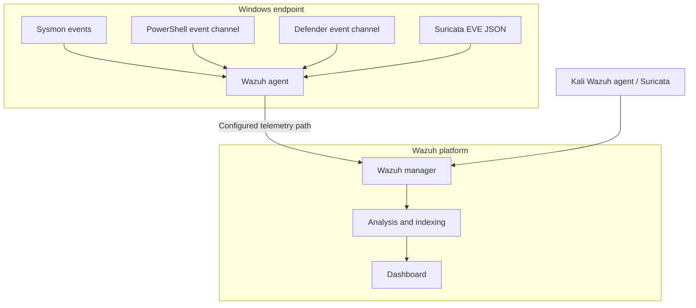

# Lab Architecture

## Environment

| Component | Role | Observed configuration |
|---|---|---|
| Wazuh manager | Central event analysis and dashboard | Amazon Linux VM; dashboard at private lab address |
| PC1_W11 | Windows endpoint | Wazuh agent, Sysmon, Microsoft Defender, Suricata |
| Kali sensor | Linux security sensor | Suricata and Wazuh agent |

Private lab IP addresses are intentionally omitted from public documentation.

## Telemetry paths

1. **Windows event channels → Wazuh agent → manager:** Sysmon Operational, PowerShell Operational and Windows Defender Operational are configured as monitored sources. The Windows agent log confirms that it analyzes these channels.
2. **Suricata EVE JSON → Wazuh agent → manager:** the Windows agent is configured to monitor the local EVE JSON file. Local DNS and flow records were observed in that file.
3. **Kali agent → Wazuh manager:** the Kali endpoint has a registered Wazuh agent.

## Evidence maturity

Use these distinct stages when documenting a data source:

- **Generated:** the source created an event locally.
- **Collected locally:** the endpoint log/file contains the event.
- **Agent configured:** the Wazuh agent log confirms it is monitoring the source.
- **Manager received:** raw event is confirmed on the Wazuh manager.
- **Indexed / alerted:** event is searchable in the relevant Wazuh index or generated a dashboard alert.

A configured agent input is not proof that an event was received, indexed, or alerted. The Defender 1116/1117 events and Suricata EVE ingestion remain subject to manager-side verification.

## Network visibility caveat

VMware network mode and subnet placement affect which traffic a sensor can observe. A host-only or isolated virtual network does not automatically provide visibility into all host, Wi-Fi, or external network traffic. Validate the capture interface and traffic path before interpreting an absence of alerts.

## Architecture diagram

